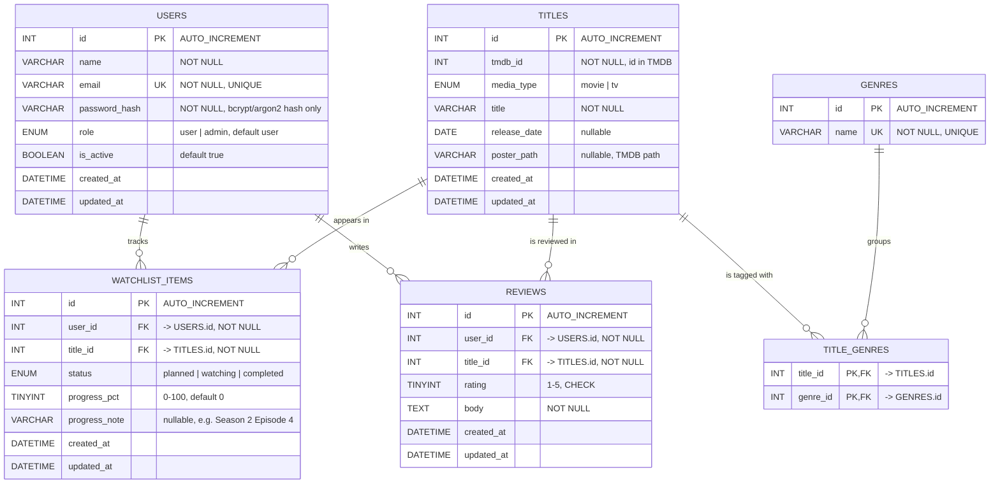

# CineTrack – Draft ERD (Milestone 1)

> **Planning artifact.** This is a design draft, not a finished database. The real MySQL schema, SQL export and sample data are delivered in Milestone 2, and the schema may be refined then.

## Diagram

`TITLE_GENRES` is the junction table that turns the many-to-many relationship between titles and genres into two one-to-many relationships.

## Entities

| Entity | Purpose |
|--------|---------|
| **users** | Registered accounts. Stores a password **hash** (never the password) and the role (`user` or `admin`). |
| **titles** | Movies and TV shows known to CineTrack. A row is created locally when a user first adds a TMDB title (or an admin adds one). |
| **genres** | Genre names used to categorise titles. Managed by admins. |
| **title_genres** | Junction table linking titles and genres (many-to-many). |
| **watchlist_items** | One user tracking one title, with a status and optional progress. |
| **reviews** | One user's rating (1–5) and written review of one title. |

Five main entities (users, titles, genres, watchlist_items, reviews) plus one junction table, which satisfies the "at least 5 entities" requirement.

## Relationships and cardinalities

| Relationship | Cardinality | Meaning |
|--------------|-------------|---------|
| users → watchlist_items | 1 : 0..N | A user can track many titles. |
| titles → watchlist_items | 1 : 0..N | A title can be on many users' watchlists. |
| users → reviews | 1 : 0..N | A user can write many reviews. |
| titles → reviews | 1 : 0..N | A title can have many reviews. |
| titles ↔ genres | N : M via `title_genres` | A title has several genres; a genre has several titles. |

## Constraints

- **Primary keys:** every table has an `id`; `title_genres` uses the composite key (`title_id`, `genre_id`).
- **Unique:** `users.email`; `genres.name`; `titles (tmdb_id, media_type)` (TMDB reuses ids across movies and TV, so both columns are needed); `watchlist_items (user_id, title_id)`; `reviews (user_id, title_id)`.
- **Checks:** `reviews.rating` between 1 and 5; `watchlist_items.progress_pct` between 0 and 100.
- **Foreign keys and delete rules** (so nothing is left orphaned):

| Foreign key | On delete |
|-------------|-----------|
| watchlist_items.user_id → users | CASCADE (deleting a user removes their watchlist) |
| reviews.user_id → users | CASCADE |
| watchlist_items.title_id → titles | CASCADE |
| reviews.title_id → titles | CASCADE |
| title_genres.title_id → titles | CASCADE |
| title_genres.genre_id → genres | CASCADE (the genre tag disappears, the title stays) |

- **Indexes:** the unique constraints above already index `(user_id, title_id)` on watchlist and reviews; add an index on `watchlist_items.title_id` and `reviews.title_id` for the reverse lookups, and on `watchlist_items (user_id, status)` for the filtered watchlist.

## External (TMDB) data versus local data

| Stored locally in MySQL | Fetched live from TMDB through our backend |
|-------------------------|---------------------------------------------|
| `tmdb_id`, `media_type`, `title`, `release_date`, `poster_path` (needed so lists and joins work without an API call) | Overview/description, ratings, runtime, seasons, cast, search results, trending lists |
| Everything about users, watchlists and reviews | |

We deliberately do **not** copy TMDB's descriptions and ratings into our database, to avoid stale duplicates. The M1 mock data in `frontend/js/data/mock-data.js` contains overview and rating fields only because there is no TMDB connection yet; they are not part of the planned tables.

## CRUD plan and ownership

| Entity | Create | Read | Update | Delete |
|--------|--------|------|--------|--------|
| users | Anyone registers (as `user`) | Own profile; admin lists all | Own name/email/password; admin may change role and active flag | Admin only |
| titles | Created when a user adds a TMDB title; admin may add | Any logged-in user | Admin | Admin (cascades) |
| genres | Admin | Any logged-in user | Admin | Admin |
| title_genres | With title create/update | With title | With title update | With title or genre delete |
| watchlist_items | Owner | **Owner only** | **Owner only** (status, progress) | **Owner only** |
| reviews | Owner (one per title) | Owner; admin for moderation | Owner only | Owner; admin for moderation |

**Privacy decision:** administrators manage shared catalogue data (titles, genres), users' roles/active flag and review moderation. They do **not** get access to other users' private watchlists, and nobody can read password hashes through the API. Every watchlist and review query is filtered by the `user_id` taken from the verified JWT, never from a request parameter.

Items still to confirm in M2: whether a role table is worth it (the `ENUM` is simpler and enough for two roles), and whether users should be able to read other users' reviews of a title (not required by M1).
